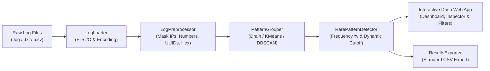

<!--
Copyright (c) 2023 Salesforce.com, inc.
All rights reserved.
SPDX-License-Identifier: BSD-3-Clause
For full license text, see the LICENSE file in the repo root or https://opensource.org/licenses/BSD-3-Clause
-->

# LogCluster — Universal Log Pattern Grouping

[](https://www.python.org/downloads/)
[](https://opensource.org/licenses/BSD-3-Clause)
[](https://dash.plotly.com/)
[]()

> **Universal Unsupervised Log Pattern Grouping & Frequency-Based Rarity Detection**  
> *A clean, modular, and student-friendly log intelligence project designed for academic presentation, college viva, and practical log analytics.*

---

## Table of Contents
1. [Problem Statement & Overview](#problem-statement--overview)
2. [Key Features](#key-features)
3. [Architecture & Workflow](#architecture--workflow)
4. [Unsupervised Learning Methodology](#unsupervised-learning-methodology)
   - [Why Predefined Labels Are Not Required](#why-predefined-labels-are-not-required)
   - [Template Extraction (Drain Algorithm) vs ML Clustering](#template-extraction-drain-algorithm-vs-ml-clustering)
   - [How the Drain Parser Works (Viva Explanation)](#how-the-drain-parser-works-viva-explanation)
   - [TF-IDF + K-Means Clustering](#tf-idf--k-means-clustering)
   - [DBSCAN Density Clustering & Noise Handling](#dbscan-density-clustering--noise-handling)
5. [Log Preprocessing & Normalization](#log-preprocessing--normalization)
6. [Statistical Rare-Pattern Identification](#statistical-rare-pattern-identification)
7. [Verified Dataset Sources & Provenance](#verified-dataset-sources--provenance)
8. [Project Structure](#project-structure)
9. [Installation & Setup](#installation--setup)
10. [Startup & Usage Guide](#startup--usage-guide)
11. [Educational Jupyter Notebook](#educational-jupyter-notebook)
12. [Sample Input & Expected Output](#sample-input--expected-output)
13. [Running Unit Tests](#running-unit-tests)
14. [Limitations & Viva Caveats](#limitations--viva-caveats)
15. [Attribution & License](#attribution--license)

---

## Problem Statement & Overview

Modern enterprise systems, cloud clusters, microservices, and mobile applications generate massive, continuous streams of unstructured text logs. Because logs are high-volume and heterogeneous:
- Engineering and operations teams are overwhelmed by millions of repetitive status and heartbeat messages.
- Identifying rare, abnormal events is like looking for a needle in a haystack.
- Existing commercial monitoring platforms are heavy, complex, expensive, and require proprietary agent daemons or external cloud subscription keys.

**LogCluster** solves this by providing a lightweight, transparent, and completely local application that:
1. Ingests raw heterogeneous log files (`.log`, `.txt`, `.csv`).
2. Normalizes volatile variable parameters (IPs, numbers, timestamps, UUIDs, memory pointers).
3. Automatically groups structurally similar raw messages into recurring human-readable templates using unsupervised algorithms.
4. Identifies statistically infrequent (rare) patterns using a dynamic, real-time frequency threshold.
5. Provides an interactive Plotly Dash dashboard with Dark/Light modes, pattern drill-down inspection, and RFC 4180 CSV export.

---

## Key Features

- **Multi-Source Log Ingestion**: Ingests `.log`, `.txt`, and structured `.csv` files with automatic column detection and fallback handling.
- **Robust Variable Normalization**: Preprocessing regex engine masks volatile parameters (IP addresses, numeric quantities, UUIDs, hex memory pointers, and file paths) without altering original verbatim messages.
- **Tree-Based Online Template Mining (Drain)**: Automatically extracts parameterized templates with wildcards (`<*>`) in linear time without manual rule authoring.
- **Alternative ML Vector Clustering**: Includes optional TF-IDF + K-Means and TF-IDF + DBSCAN (with explicit outlier noise handling) for algorithm comparison.
- **Statistical Rarity Detection**: Computes pattern occurrence counts and dataset percentages, dynamically categorizing patterns as Common or Rare.
- **Zero-Latency Threshold Updates**: Adjust the rarity threshold slider or mode in the UI to instantly recalculate rarity in memory without re-clustering.
- **Interactive Dash Dashboard**: Responsive web UI featuring summary KPI cards, top-pattern horizontal bar charts, pattern distribution donut charts, and a log explorer table with search filters.
- **Logline Inspector**: Click any row in the discovered pattern table to immediately inspect original raw messages belonging to that specific template.
- **RFC 4180 CSV Export**: Download the enriched dataset containing line numbers, raw logs, cleaned logs, pattern IDs, templates, frequencies, and rarity flags.
- **Educational Walkthrough Notebook**: Complete 12-section companion Jupyter Notebook (`LogCluster_ML_Walkthrough.ipynb`) for classroom presentation and viva demonstration.

---

## Architecture & Workflow



### High-Level Execution Pipeline
1. **Ingestion (`src/log_loader.py`)**: Universal loader reads `.log`, `.txt`, and `.csv` files into a unified Pandas DataFrame, capturing raw verbatim loglines and 1-indexed line numbers.
2. **Preprocessing (`src/log_preprocessor.py`)**: Normalizes variable volatile parameters into generalized tokens (`<NUM>`, `<IP>`, `<HEX>`, `<UUID>`, `<PATH>`) to prevent artificial template fragmentation.
3. **Pattern Grouping (`src/pattern_grouper.py`)**: Executes unsupervised pattern discovery via the tree-based Drain template algorithm, K-Means, or DBSCAN.
4. **Frequency & Rarity Analysis (`src/rare_pattern_detector.py`)**: Computes occurrence counts, dataset percentages, and determines rare patterns using a configurable cutoff threshold.
5. **Interactive Exploration & Export (`app.py`, `src/results_exporter.py`)**: Enables real-time threshold adjustment, pattern drill-down, and CSV results download.

---

## Unsupervised Learning Methodology

### Why Predefined Labels Are Not Required
In real-world production environments:
- Incoming log messages are **unlabeled**; no human annotates every log entry as "normal" or "abnormal".
- New software deployments and microservices constantly introduce **novel log formats** never seen before.
- Supervised classification models require continuous manual labeling and would fail when encountering unseen log syntax. 
- Unsupervised learning discovers patterns directly from the **syntactic structure** and **token geometry** of the data itself.

### Template Extraction (Drain Algorithm) vs ML Clustering

| Dimension | Template Extraction (Drain) | ML Clustering (TF-IDF + KMeans/DBSCAN) |
| :--- | :--- | :--- |
| **Primary Goal** | Extract exact syntactical templates with wildcards `<*>` | Group points by vector proximity in semantic space |
| **Data Representation** | Ordered sequence of discrete word tokens | Bag-of-words term frequency vectors in $\mathbb{R}^V$ |
| **Word Order Awareness** | **High**: Respects exact token positions and message length | **Low**: Word order is lost in standard vector space models |
| **Time Complexity** | $O(N)$ linear time — fast and lightweight | $O(N \cdot K \cdot I)$ or $O(N^2)$ — slower on large datasets |
| **Interpretability** | Produces exact templates: `onStandStepChanged <NUM>` | Produces cluster centroids requiring medoid mapping |
| **Number of Clusters** | Discovered dynamically based on similarity threshold | Must specify $K$ beforehand (KMeans) or tune $\varepsilon$ (DBSCAN) |
| **Best Used For** | Operational logs with fixed structure and variable parameters | Free-text unstructured error descriptions |

### How the Drain Parser Works (Viva Explanation)
**Drain** is an online, tree-based log parser designed specifically for computer systems logs:
1. **Length-Based Grouping (Level 1)**: First, it looks up the node matching the number of tokens (words) in the log line.
2. **Prefix-Tree Traversal (Level 2 to Depth)**: It traverses the internal tree matching the leading tokens. If a token contains numbers or variable markers, it follows the wildcard `<*>` branch.
3. **Similarity Comparison**: At the leaf node, candidate log templates are compared using token-level similarity:
   $$\text{Similarity}(T_1, T_2) = \frac{\sum_{i=1}^L \mathbb{I}(t_{1,i} == t_{2,i} \text{ or } t_{1,i} == \text{"<*>"} )}{L}$$
4. **Template Update / Creation**:
   - If $\text{Similarity} \ge \text{threshold}$ (default `0.5`), the log matches the cluster, and differing token positions are updated to wildcards `<*>`.
   - If no candidate matches, a new cluster/template is spawned.

### TF-IDF + K-Means Clustering
When K-Means is selected:
- Cleaned log messages are transformed into numerical feature vectors via `TfidfVectorizer(max_features=1000, stop_words="english")`.
- Vectors are partitioned into $k$ clusters (default $k=5$) using standard Euclidean centroid optimization.
- The representative pattern for each cluster is determined by the statistical mode (`.mode().iloc[0]`, the most frequent sentence in that cluster).

### DBSCAN Density Clustering & Noise Handling
When density-based clustering (DBSCAN) is selected:
- Features are extracted via TF-IDF vectorization with cosine distance metric.
- Points with fewer than `min_samples` neighbors within distance $\varepsilon$ are classified as **noise** (label `-1`).
- **Explicit Noise Handling**: Rather than discarding outliers or incorrectly treating each outlier as an independent cluster, LogCluster marks label `-1` as `<DBSCAN_NOISE_POINT / UNGROUPED_OUTLIER>`, maintaining complete record conservation.

---

## Log Preprocessing & Normalization

Variables like IP addresses, timestamps, and numbers differ on every line. If untreated, they prevent similar messages from grouping. Preprocessing normalizes them using regular expressions in [`LogPreprocessor`](src/log_preprocessor.py):

| Raw Pattern | Standardized Token | Example Transformation |
| :--- | :--- | :--- |
| ISO / Syslog Timestamp | *(stripped)* | `2026-10-20 10:00:01 INFO Started` $\to$ `INFO Started` |
| IPv4 Address | `<IP>` | `Connected from 192.168.1.105:8080` $\to$ `Connected from <IP>` |
| Numeric Identifier | `<NUM>` | `User 101 logged in after 20 seconds` $\to$ `User <NUM> logged in after <NUM> seconds` |
| UUID / GUID | `<UUID>` | `Session 123e4567-e89b-12d3-a456... expired` $\to$ `Session <UUID> expired` |
| Hexadecimal Hash | `<HEX>` | `Kernel panic at address 0x7fff89ab` $\to$ `Kernel panic at address <HEX>` |
| File System Path | `<PATH>` | `Failed opening /var/log/nginx/access.log` $\to$ `Failed opening <PATH>` |

*Original raw messages are never discarded or overwritten; the preprocessor appends the normalized text into a new `cleaned_log` column.*

---

## Statistical Rare-Pattern Identification

In LogCluster, rare patterns are identified using **pure occurrence frequency statistics**:
$$\text{Frequency Percentage} = \left(\frac{\text{Pattern Count}}{\text{Total Processed Logs}}\right) \times 100\%$$

- **Rarity Rule**: A pattern is categorized as **Rare** if:
  $$\text{Frequency Percentage} \le \text{Threshold } (\%)$$
  *(or alternately if absolute count $\le N$)*
- **Dynamic In-Memory Re-evaluation**: Because rarity is statistical, users can adjust the threshold in the UI and recalculate rarity instantly in $O(1)$ time without re-running parsing or clustering algorithms.
- **Important Viva Distinction**: *A rare pattern is a statistical outlier—it is NOT automatically a system failure, malicious attack, or confirmed anomaly. It represents an infrequent operational event.*

---

## Verified Dataset Sources & Provenance

LogCluster includes verified, public benchmark log datasets sourced from **[LogHub](https://github.com/logpai/loghub)** (CUHK LogPAI research team). All unverified or synthetic sample files have been removed.

| Dataset Name | Official Source URL | Local Filename | Verified Subset & Provenance Information |
| :--- | :--- | :--- | :--- |
| **HealthApp System Logs** | [LogHub HealthApp Repository](https://github.com/logpai/loghub/tree/master/HealthApp) | `HealthApp_2000.log` | 2,000-line benchmark subset derived directly from the official `HealthApp_2k.log` benchmark. Android mobile health app logs in `<Time>\|<Component>\|<Pid>\|<Content>` format (1,999 non-empty records). |
| **BlueGene/L Supercomputer Logs (BGL)** | [LogHub BGL Repository](https://github.com/logpai/loghub/tree/master/BGL) | `BGL_2000.log` | 2,000-line benchmark subset derived directly from the official `BGL_2k.log` benchmark collected at Lawrence Livermore National Laboratory (LLNL). `<AlertFlag> <Timestamp> <Date> <Node> <Time> <NodeRepeat> <Type> <Component> <Level> <Content>` format (2,001 non-empty records). |
| **Hadoop Distributed File System (HDFS)** | [LogHub HDFS Repository](https://github.com/logpai/loghub/tree/master/HDFS) | `HDFS_2000.log` | 2,000-line benchmark subset derived directly from the official `HDFS_2k.log` benchmark collected from Hadoop MapReduce jobs on Amazon EC2. `<Date> <Time> <Pid> <Level> <Component>: <Content>` format (2,001 non-empty records). |

*Note on Subsets:* The original raw research datasets at LogHub contain millions of lines (e.g., 4.7 million for BGL, 11 million for HDFS). The project includes the standard 2,000-line benchmark subsets (`*_2k.log`) designed specifically for efficient academic evaluation and rapid local testing.

---

## Project Structure

```
logcluster/
├── app.py                             # Main Plotly Dash web application (Light/Dark themes & vector icons)
├── LogCluster_ML_Walkthrough.ipynb    # Complete 12-section educational walkthrough notebook
├── README.md                          # Comprehensive project documentation
├── requirements.txt                   # Minimal, tested project dependencies
├── setup.py                           # Package configuration (BSD-3-Clause attribution)
├── setup.cfg                          # Tool configuration (flake8, pytest)
├── LICENSE.txt                        # BSD-3-Clause license text
├── run_tests.py                       # Standalone test runner (24 passing tests)
├── assets/                            # Frontend static assets & theme engine
│   ├── favicon.ico                    # Application favicon
│   ├── styles.css                     # Custom design system with shared Light/Dark CSS variables
│   ├── theme.js                       # Instant theme initialization (zero-flash + localStorage)
│   ├── logo.jpg                       # High-resolution generated branding asset
│   └── icons/                         # Vector SVG icon library (15 icons: logo, sun, moon, etc.)
├── data/                              # Verified benchmark datasets from LogHub
│   ├── HealthApp_2000.log             # HealthApp mobile system logs (1,999 non-empty records)
│   ├── BGL_2000.log                   # BlueGene/L supercomputer logs (2,001 non-empty records)
│   └── HDFS_2000.log                  # Hadoop distributed file system logs (2,001 non-empty records)
├── src/                               # Core modular backend components
│   ├── __init__.py                    # Package exports
│   ├── icons.py                       # Accessible vector icon system & branding components
│   ├── log_loader.py                  # Multi-format ingestion (.log, .txt, .csv)
│   ├── log_preprocessor.py            # Variable-value normalization regex engine
│   ├── pattern_grouper.py             # Drain algorithm & TF-IDF clustering
│   ├── rare_pattern_detector.py       # Frequency calculation & dynamic thresholding
│   └── results_exporter.py            # RFC 4180 CSV export generation
└── tests/                             # Comprehensive test suite (24 tests)
    ├── __init__.py
    ├── test_file_loader.py            # Ingestion & edge case tests (7 tests)
    ├── test_preprocessing.py          # Token normalization tests (5 tests)
    ├── test_pattern_grouping.py       # Template extraction & noise tests (3 tests)
    ├── test_rare_patterns.py          # Rarity thresholding & frequency tests (4 tests)
    ├── test_results_exporter.py       # CSV export format tests (2 tests)
    └── test_icons.py                  # Icon system & theme asset tests (3 tests)
```

---

## Installation & Setup

### Prerequisites
- Python 3.8 to 3.11
- Operating System: Windows, macOS, or Linux

### 1. Create and Activate Virtual Environment
```bash
# Windows (PowerShell)
python -m venv .venv
.\.venv\Scripts\Activate.ps1

# Linux / macOS
python3 -m venv .venv
source .venv/bin/activate
```

### 2. Install Dependencies
```bash
pip install -r requirements.txt
```

*(Optional) To run and edit the Jupyter notebook:*
```bash
pip install ipykernel nbformat nbclient
```

---

## Startup & Usage Guide

### Launching the Web Application
Start the application from the project root:

```bash
python app.py
```

Open your browser and navigate to:
```
http://127.0.0.1:8050/
```

### Exploring the Interface Tabs
1. **Dashboard**: High-level KPIs (Total Logs, Discovered Patterns, Rare Patterns, Compression Ratio) and top pattern bar/donut distribution charts.
2. **Upload & Ingest**: Select a verified LogHub benchmark dataset (`HealthApp_2000.log`, `BGL_2000.log`, or `HDFS_2000.log`) or drag-and-drop your own log or CSV file. Customize grouping algorithm (Drain, KMeans, DBSCAN) and click **"Process Logs"**.
3. **Pattern Groups**: Interactive table showing Pattern IDs, templates, counts, percentages, and status. Clicking any row opens the **Logline Inspector** to view verbatim raw messages belonging to that pattern.
4. **Rare Patterns**: Dedicated view of infrequent patterns with the **Dynamic Threshold Adjuster**. Change threshold percentage and click **"Update Rarity Threshold"** to see instant updates without re-clustering.
5. **Log Explorer**: Search and filter all original logs by keyword, Pattern ID, or rarity status (All, Rare Only, Common Only).
6. **Export Results**: Download the enriched dataset as `logcluster_results.csv`.

---

## Educational Jupyter Notebook

A companion educational notebook is included in the project root: **`LogCluster_ML_Walkthrough.ipynb`**.

### How to Open and Run the Notebook
```bash
# Open directly in VS Code / Cursor / PyCharm, or launch via browser:
python -m jupyter notebook LogCluster_ML_Walkthrough.ipynb
```

### Notebook Content & Structure
The notebook contains **12 fully executed sections** with live outputs, data tables, and Matplotlib visualizations:
- **Section 1**: Project introduction, motivation, and template mining vs. clustering comparison.
- **Section 2**: Library imports and verification.
- **Section 3**: Loading `HealthApp_2000.log` from `data/`.
- **Section 4**: Data inspection, record counts, and structural observations.
- **Section 5**: Log preprocessing with before-and-after comparison table.
- **Section 6**: Feature extraction: Drain prefix tree vs. TF-IDF vector matrix.
- **Section 7**: Unsupervised pattern grouping: Drain execution (74 patterns, 96.3% compression) and comparison with K-Means & DBSCAN.
- **Section 8**: Pattern frequency calculations and Top 10 frequency table.
- **Section 9**: Dynamic rare-pattern detection and threshold adjustment.
- **Section 10**: Embedded visualizations (horizontal bar chart, common vs. rare donut chart, long-tail decay curve).
- **Section 11**: Validation: record conservation check (1,999 = 1,999), 100% percentage sum check, and drill-down inspection.
- **Section 12**: Conclusion, limitations, and a 5-question Viva Q&A guide.

---

## Sample Input & Expected Output

### Input Example (`data/HealthApp_2000.log`)
```
20171223-22:15:29:606|Step_LSC|30002312|onStandStepChanged 3579
20171223-22:15:29:615|Step_LSC|30002312|onExtend:1514038530000 14 0 4
20171223-22:15:29:633|Step_StandReportReceiver|30002312|onReceive action: android.intent.action.SCREEN_ON
20171223-22:15:29:635|Step_LSC|30002312|processHandleBroadcastAction action:android.intent.action.SCREEN_ON
20171223-22:15:29:635|Step_StandStepCounter|30002312|flush sensor data
```

### Discovered Pattern Groups (Sample under Drain `sim_threshold=0.5`)
| Pattern ID | Representative Pattern Template | Occurrences | Dataset % | Status ($\le 15\%$ Threshold) |
| :---: | :--- | :---: | :---: | :---: |
| **0** | `onStandStepChanged <NUM>` | 342 | 17.11% | Common |
| **1** | `processHandleBroadcastAction action:android.intent.action.SCREEN_ON` | 56 | 2.80% | Rare |
| **2** | `flush sensor data` | 48 | 2.40% | Rare |
| **3** | `onExtend:<NUM> <NUM> <NUM> <NUM>` | 38 | 1.90% | Rare |

### KPI Metrics Interpretation
- **Total Log Entries**: `1,999` non-empty log lines processed.
- **Discovered Patterns**: `74` unique templates extracted.
- **Compression Ratio**: $(1.0 - (74 / 1999)) \times 100\% = \mathbf{96.30\%}$ volume consolidation.
- **Rare Patterns**: Count of templates meeting the rarity threshold cutoff.

---

## Running Unit Tests

Execute the comprehensive test suite to verify all modules:

```bash
python run_tests.py
```

### Verified Test Suite Results (24 Passed, 0 Failed)
```
==================================================
      Running LogCluster Test Suite               
==================================================

[Suite] File Loader Tests
  PASS: test_load_csv_autodetect_column
  PASS: test_load_csv_file
  PASS: test_load_empty_file
  PASS: test_load_from_bytesio
  PASS: test_load_nonexistent_file
  PASS: test_load_text_file
  PASS: test_unsupported_format

[Suite] Preprocessing Tests
  PASS: test_ip_normalization
  PASS: test_number_normalization
  PASS: test_timestamp_removal
  PASS: test_transform_dataframe
  PASS: test_uuid_normalization

[Suite] Pattern Grouping Tests
  PASS: test_dbscan_noise_handling
  PASS: test_drain_pattern_grouping
  PASS: test_kmeans_pattern_grouping

[Suite] Rare Pattern Detector Tests
  PASS: test_annotate_records
  PASS: test_count_based_threshold
  PASS: test_dynamic_threshold_update
  PASS: test_frequency_calculation

[Suite] Results Exporter Tests
  PASS: test_export_to_csv_file
  PASS: test_export_to_csv_string

[Suite] Icon System Tests
  PASS: test_get_icon
  PASS: test_get_logo_brand
  PASS: test_icon_mapping

==================================================
Results: 24 passed, 0 failed.
==================================================
```

---

## Limitations & Viva Caveats

1. **Rarity Does Not Imply Threat/Failure**: A rare pattern is purely a statistical frequency outlier. An infrequent event may be a scheduled background task or a rare maintenance routine, not necessarily a security breach or crash.
2. **Preprocessing Sensitivity**: The quality of discovered templates depends on the normalization regular expressions. Non-standard timestamp formats (such as compact dates `20171223-22:15...` without hyphens) are normalized as `<NUM>` rather than stripped.
3. **Arrival Order Sensitivity**: Online streaming parsers like Drain process logs sequentially; the exact wildcarding of templates can vary slightly depending on the arrival order of logs.
4. **Batch Processing**: The application currently processes files in batches. In a future production deployment, streaming ingestion via WebSockets, Apache Kafka, or log forwarders could be added.
5. **No Ground-Truth Accuracy Claim**: Because this is an unsupervised learning pipeline operating on raw operational logs, conventional supervised metrics (Accuracy, F1-Score, Precision/Recall) are not applicable and should not be claimed during presentation.

